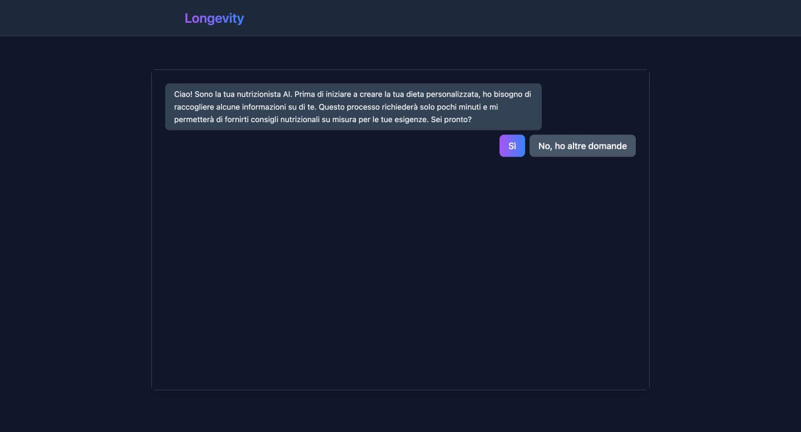

# Longevity — AI Nutrition Assistant

A nutrition chat assistant that **computes numbers with code, not with a language model**, and answers questions **only from indexed scientific documents**, with page-accurate citations.

**Live demo:** https://longevity-alpha.vercel.app (Italian UI)



## The idea

A nutritionist's knowledge comes from documents: papers, guidelines, studies. A RAG system can answer from the same documents, but a model asked to do arithmetic or to "know" an answer it was never shown will make things up. Longevity splits the work so the model never gets to invent a number or a source.

## How it works

Three parts, all in this repo as Next.js API routes (`app/api/*`):

1. **Deterministic nutrition engine** (`lib/domain/`) — BMI, BMR (Mifflin–St Jeor), TDEE, calorie target and macro split from a user profile. Pure functions, no LLM, no network. Every constant carries its citation, and a test enforces that. Verified against golden profiles.
2. **Constrained meal-plan pipeline** (`POST /api/plan`, `lib/llm/`) — the model's output schema holds only `{food_key, grams}` per item, never calories or macros. Totals are computed server-side from a curated Italian food database (~70 items, Atwater-checked at load). A plan outside tolerance is first repaired without the model (scaling and nudging), and at most once sent back with the server-computed deltas; if it still doesn't land, the API returns targets only instead of a wrong plan. Also: ingredient swaps, regenerating a meal/day/plan, and free-text editing with intent parsing.
3. **Retrieval-honest Q&A** (`POST /api/ask`, `lib/rag/`) — Supabase/pgvector semantic search with a real similarity threshold: below it, **the model is not called at all** and a deterministic "not in my sources" message is returned. Chunks carry page numbers; citations are returned as structured data, and any `[n]` marker the model emits outside the supplied context is stripped server-side.

The chat also runs a short intake (age, weight, height, activity, goals) to personalise the guidance.

## Stack

Next.js 14 (App Router) + React 18, OpenAI (chat and embeddings), Supabase Postgres + pgvector, Vitest, GitHub Actions CI. Deployed on Vercel.

> History: the first version had a separate FastAPI backend on Render and a Pinecone index. On 2026-10-06 it was retired and ported into this repo; the old code is kept as a record in [longevity-backend](https://github.com/daro-hub/longevity-backend) (deprecated).

## Run it

```bash
cp .env.example .env.local   # OPENAI_API_KEY, SUPABASE_DB_URL, ...
npm install
npm run dev                  # http://localhost:3000
```

Or with Docker (not yet tested on my machine, see note below):

```bash
docker compose up --build
```

Index the documents into pgvector with `node scripts/index-docs.mjs` (see `data/manifest.json`).

## Tests

```bash
npm test          # 285 unit tests: engine, plan pipeline, RAG chunking/retrieval/citations
npm run typecheck
```

The tests use synthetic data and mocked model clients, so they need no API keys or database.

## Known limits

- The retrieval threshold is provisional until it is tuned against a labeled eval set; the mechanism around it is tested.
- Informational only: not medical advice.
- The Docker setup was written but not built on my machine (no Docker installed there when I wrote it); the app itself runs with `npm`.
